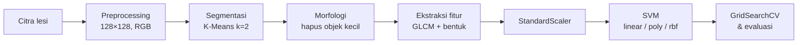
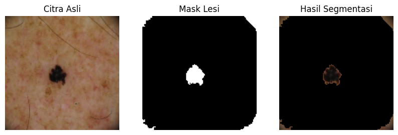
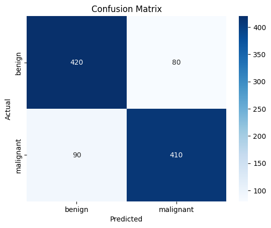

<div align="center">

# 🔬 Skin Cancer Classification with SVM

Klasifikasi citra lesi kulit menjadi **benign** (jinak) dan **malignant** (ganas)
menggunakan segmentasi K-Means, fitur tekstur GLCM, dan Support Vector Machine.


</div>

> [!WARNING]
> Proyek ini dibuat untuk pembelajaran dan portofolio. Hasil model **bukan diagnosis medis** dan tidak boleh digunakan sebagai pengganti pemeriksaan tenaga medis profesional.

## 📑 Daftar Isi

- [Ringkasan](#-ringkasan)
- [Pipeline](#-pipeline)
- [Tangkapan Layar](#-tangkapan-layar)
- [Hasil Eksperimen](#-hasil-eksperimen)
- [Dataset](#-dataset)
- [Struktur Repository](#-struktur-repository)
- [Instalasi & Menjalankan](#-instalasi--menjalankan)
- [Teknologi](#-teknologi)
- [Catatan Pengembangan](#-catatan-pengembangan)
- [Author](#-author)

## 📌 Ringkasan

| | |
|---|---|
| **Tugas** | Klasifikasi biner citra dermoskopi (benign vs malignant) |
| **Pendekatan** | Computer vision klasik + machine learning (tanpa deep learning) |
| **Fitur** | 4 fitur tekstur GLCM + 2 fitur bentuk |
| **Model terbaik** | SVM RBF (`C=100`, `gamma=1`) |
| **Akurasi terbaik** | **83,0%** pada 1.000 citra test |

## ⚙️ Pipeline



1. **Preprocessing** — ubah ukuran citra menjadi 128 × 128 piksel dan konversi warna ke RGB.
2. **Segmentasi lesi** — K-Means clustering (`k=2`); cluster dengan rata-rata warna paling gelap diasumsikan sebagai area lesi.
3. **Post-processing** — hapus objek kecil dari mask menggunakan operasi morfologi.
4. **Ekstraksi fitur** — tekstur GLCM (`contrast`, `correlation`, `energy`, `homogeneity`) dan bentuk (`area`, `perimeter`).
5. **Normalisasi** — `StandardScaler` (fit pada data training, transform pada data test).
6. **Klasifikasi** — bandingkan SVM kernel `linear`, `poly`, dan `rbf`.
7. **Tuning & evaluasi** — `GridSearchCV` (10-fold) lalu evaluasi dengan accuracy, precision, recall, F1-score, dan confusion matrix.

## 🖼️ Tangkapan Layar

### Hasil Segmentasi Lesi

Contoh citra asli, mask lesi hasil K-Means + morfologi, dan area lesi yang tersegmentasi.



### Confusion Matrix (SVM RBF setelah tuning)

<p align="center">
  
</p>

Dari 1.000 citra test, model memprediksi benar **420 benign** dan **410 malignant**. Terdapat **90 kasus malignant yang terprediksi benign** (false negative) — jenis kesalahan yang paling perlu diperhatikan dalam konteks medis.

## 📊 Hasil Eksperimen

| Model | Accuracy | Precision (macro) | Recall (macro) | F1 (macro) |
|---|---:|---:|---:|---:|
| SVM Linear | 79,5% | 0,80 | 0,79 | 0,79 |
| SVM Polynomial | 76,9% | 0,80 | 0,77 | 0,76 |
| SVM RBF | 81,2% | 0,82 | 0,81 | 0,81 |
| **SVM RBF + tuning** (`C=100`, `gamma=1`) | **83,0%** | **0,83** | **0,83** | **0,83** |

<details>
<summary>Detail per kelas — SVM RBF setelah tuning</summary>

| Kelas | Precision | Recall | F1-score | Support |
|---|---:|---:|---:|---:|
| benign | 0,82 | 0,84 | 0,83 | 500 |
| malignant | 0,84 | 0,82 | 0,83 | 500 |

</details>

> [!NOTE]
> Angka di atas diambil dari output yang tersimpan di notebook dan dapat berubah jika dataset, lingkungan, atau parameter berbeda. Jalankan ulang notebook untuk memverifikasi sebelum menggunakannya dalam laporan.

## 📂 Dataset

**[Melanoma Skin Cancer Dataset of 10,605 Images](https://www.kaggle.com/datasets/hasnainjaved/melanoma-skin-cancer-dataset-of-10000-images)** — Kaggle, oleh Hasnain Javed.

- Dataset **tidak disertakan** dalam repository ini; unduh langsung dari sumbernya.
- Baca ketentuan penggunaan dan lisensi dataset sebelum mendistribusikan atau menggunakannya untuk tujuan lain.

Setelah diunduh dan diekstrak, susun folder seperti berikut (sesuaikan jika nama folder dari arsip Kaggle berbeda):

```text
data/
├── train/
│   ├── benign/
│   └── malignant/
└── test/
    ├── benign/
    └── malignant/
```

## 🗂️ Struktur Repository

```text
skin-cancer-classification/
├── assets/                # gambar untuk README
│   ├── segmentation_sample.png
│   └── confusion_matrix.png
├── data/                  # dataset (diabaikan Git, unduh sendiri)
├── notebooks/
│   └── skin_cancer_classification.ipynb
├── results/               # output eksperimen
├── .gitignore
├── requirements.txt
└── README.md
```

Folder `data/` sengaja diabaikan oleh Git agar repository tetap ringan dan menghormati ketentuan distribusi dataset.

## 🚀 Instalasi & Menjalankan

Disarankan menggunakan **Python 3.10 atau 3.11**.

**1. Clone repository**

```bash
git clone https://github.com/ryanmhildan/skin-cancer-classification.git
cd skin-cancer-classification
```

**2. Buat dan aktifkan virtual environment**

```bash
# Windows
python -m venv .venv
.venv\Scripts\activate

# Linux / macOS
python3 -m venv .venv
source .venv/bin/activate
```

**3. Pasang dependensi**

```bash
pip install -r requirements.txt
```

**4. Siapkan dataset** — unduh dari Kaggle, ekstrak, lalu letakkan di folder `data/` sesuai struktur di atas.

**5. Jalankan notebook**

```bash
jupyter notebook
```

Buka `notebooks/skin_cancer_classification.ipynb` dan jalankan sel secara berurutan.

> [!TIP]
> Notebook awalnya dibuat di **Google Colab** dan membaca dataset dari Google Drive. Untuk menjalankan secara lokal, lewati sel `drive.mount(...)` dan ubah `DATASET_TRAIN_PATH` / `DATASET_TEST_PATH` menjadi `data/train` dan `data/test`. Pastikan nama folder kelas adalah `benign` dan `malignant`.

## 🛠️ Teknologi

| Kategori | Library |
|---|---|
| Pengolahan citra | OpenCV, scikit-image |
| Data | NumPy, Pandas |
| Machine learning | scikit-learn |
| Visualisasi | Matplotlib, Seaborn |
| Lingkungan | Jupyter Notebook / Google Colab |

## 📝 Catatan Pengembangan

- **Segmentasi** — validasi hasil secara visual; asumsi bahwa lesi selalu menjadi cluster paling gelap tidak selalu benar (misalnya pada citra dengan vignette gelap di tepi, seperti terlihat pada contoh di atas).
- **Kebocoran data** — pastikan `StandardScaler` hanya di-fit pada data training dan tuning hanya memakai data training.
- **Metrik tambahan** — pertimbangkan ROC-AUC dan analisis false negative, mengingat konteksnya adalah deteksi lesi ganas.
- **Pengembangan lanjut** — coba fitur warna (histogram, color moments), fitur bentuk tambahan (asimetri, kebulatan), atau pendekatan CNN/transfer learning sebagai pembanding.

## 👤 Author

**Ryan Muhammad Hildan** — proyek portofolio machine learning & computer vision.

[](https://github.com/ryanmhildan)
